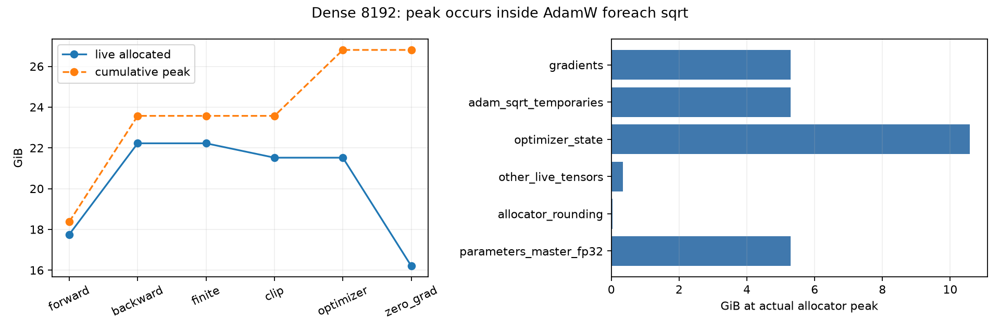
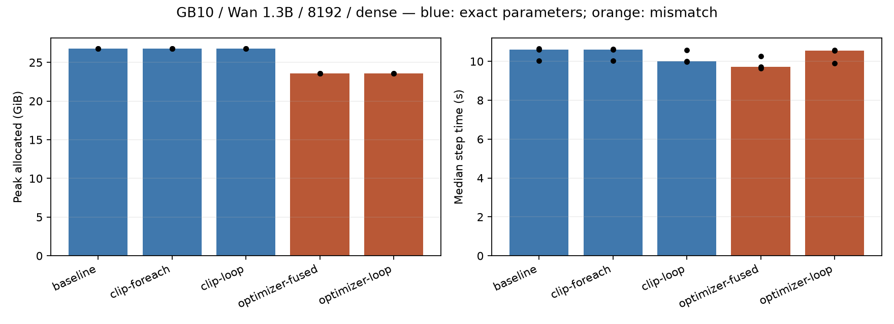
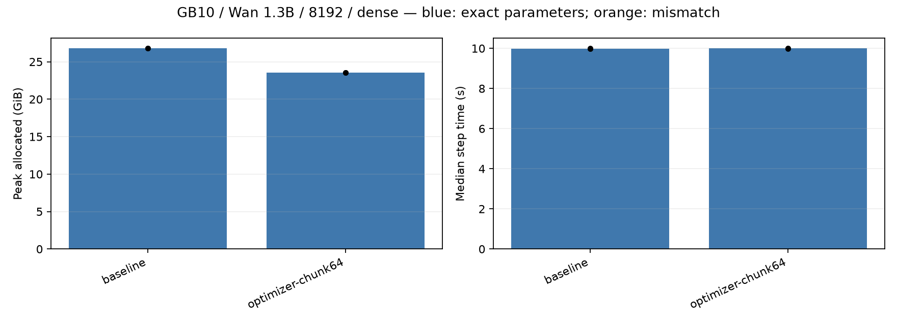

# GB10 dense 8192: post-backward peak attribution

New reproduction on this GB10, 2026-10-29. Historical acceptance is not inherited.
Base: `4d515657f40397c59df775e1175e79bdf8a202b6` (`handoff/gb10-spark-stats`).
The QAT kernel, dense default, TMA stores, model and production optimizer code are unchanged.

## Findings

The **26.805254 GiB peak is inside AdamW**, not the backward or gradient-finiteness check.
The largest persistent component is the two FP32 Adam moment tensors: **10.572350 GiB**.
The allocation that raises the step peak is the foreach AdamW square-root tensor list:
**5.286175 GiB**, one FP32 parameter-sized temporary list.

The best tested result-preserving intervention is the private **64-tensor chunked foreach**
experiment. It retains the installed AdamW foreach implementation and arithmetic, but invokes it
on consecutive lists of at most 64 tensors. It does not switch to the scalar or fused backend.

- Peak allocated: **26.805254 → 23.570627 GiB**, saving **3.234627 GiB / 12.0671%**.
- Peak reserved: **29.451172 → 26.183594 GiB**, saving **3.267578 GiB**.
- All **825 final parameter byte hashes**, four losses and four gradient norms match the paired dense
  control in all three independent rounds. Each backward had 825/825 accumulation events.
- Paired step-time changes: **−0.1520%, +0.1363%, +0.0212%**. Busy-clock P10/P50/P90 were
  **1794/1794/1794 MHz in all six runs**. These small differences do not demonstrate a speed improvement.
- The remaining peak is the backward allocation peak. Eliminating all 5.286 GiB of optimizer scratch
  cannot reduce the whole-step peak by that full amount, because backward becomes the limiting phase.

This is a bounded four-update, G1, 8192-token experiment, not a long-training or video-quality
claim. Actual full-model optimizer-state tensors were not hashed; the CPU chunking test also checks
optimizer states. No production default has been changed or PR opened.

## Exact live peak accounting

The diagnostic invokes the original `torch._foreach_sqrt` once with unchanged arguments and records
the snapshot while its result is still live. The sum below equals both the snapshot's active block
bytes and `torch.cuda.max_memory_allocated()`: **28,781,922,816 bytes**.

| Category | Bytes | GiB |
|---|---:|---:|
| Trainable FP32 parameters / master weights | 5,675,987,200 | 5.286175 |
| FP32 gradients | 5,675,987,200 | 5.286175 |
| Adam first and second moments | 11,351,974,400 | 10.572350 |
| Adam foreach square-root temporaries | 5,675,987,200 | 5.286175 |
| Other live allocations | 369,182,720 | 0.343828 |
| Allocator padding for identified storages | 32,804,096 | 0.030551 |

FP32 master weights are the same storage as the trainable parameters, **not an extra copy**.
Storage identities are deduplicated, including flat gradient storage shared by parameter views.
Of the other allocations, 302,073,856 bytes have VAE initialization/conversion stacks
(`WanModel.init_preprocessors` → VAE loader), 33,554,432 bytes originate in a linear operation,
and 33,554,432 bytes have no recorded Python allocation stack. The VAE number includes block
padding; the unrecorded block remains unattributed rather than being assigned a guessed purpose.
These are PyTorch allocator measurements, not all device/driver memory.

An initial event-only trace replay underestimated the peak because allocation events omit padding
in reused unsplit blocks. `peak_trace.py` explicitly labels that estimate; the exact live snapshot
above is authoritative. Initial raw evidence remains local. The exact-snapshot observer's final
parameter hashes match the initial unwrapped two-update profiling run.

## Phase measurements

Steady step after one warmup, unchanged dense. Cumulative peak is distinct from live allocated memory.

| Boundary | Live allocated GiB | Cumulative peak GiB |
|---|---:|---:|
| Forward end | 17.754694 | 18.377460 |
| Backward end | 22.224158 | 23.570627 |
| Gradient finite check end | 22.224158 | 23.570627 |
| Clip end | 21.519079 | 23.570627 |
| AdamW step end | 21.519079 | 26.805254 |
| zero_grad end | 16.208213 | 26.805254 |

The existing harness releases loss/output references before clip; this explains the live-memory
reduction at that boundary. It does not change the dominant AdamW peak.



## Isolated interventions and failures

Each process uses a fresh output directory and identical initial weights, input, seed and recipe.
The first matrix uses three randomized rounds, one warmup and three measured updates per run.
The table shows round-zero time, where all five busy-clock distributions were 1794 MHz;
all rounds and clocks are retained in the JSON/CSV. Later rounds include thermal clock differences,
so their raw timing ratios are **not** unconditional speedup evidence.

| Intervention | Peak allocated GiB | Peak reserved GiB | Round-zero median seconds | Final parameters equal? |
|---|---:|---:|---:|---|
| Original dense / auto foreach | 26.805254 | 29.451172 | 10.040146 | Yes |
| Explicit foreach norm/clip | 26.805254 | 29.451172 | 10.032153 | Yes |
| For-loop norm/clip | 26.805254 | 29.451172 | 9.991408 | Yes |
| Non-fused, scalar-loop AdamW | 23.571604 | 25.945312 | 9.900594 | **No** |
| Fused AdamW | 23.571997 | 25.927734 | 9.717734 | **No** |
| Assign BF16 gradients to FP32 parameters | N/A | N/A | N/A | Rejected before update |
| Release gradients before checking them | N/A | N/A | N/A | Missing-gradient guard stopped update |

Scalar-loop and fused AdamW completed execution but fail the required byte-equality criterion:
all 825 final parameter hashes differ from the corresponding baseline. They are not accepted as
lossless alternatives. BF16 assignment fails the installed parameter/gradient dtype contract;
we do not bypass it via `.data` or weaken the dtype contract. Early gradient release fails the
coverage check, so there is no optimizer update. Those two attempts stop during warmup, have no
completed step or valid steady-state timing/hash comparison, and did not serialize allocator peaks;
N/A must not be interpreted as zero memory. No failed attempt was automatically retried.



The separate chunking follow-up uses new runs and a separately randomized order, with cooling to
40°C or below before each process. Cooling is outside the measured step and recorded separately.
Each run still has one warmup and three measured updates. It uses no allocator-history observer.

| Paired round | Dense seconds | Chunk64 seconds | Change | Parameter hashes |
|---|---:|---:|---:|---|
| 0 | 10.006682 | 9.991470 | −0.1520% | 825/825 equal |
| 1 | 9.981572 | 9.995175 | +0.1363% | 825/825 equal |
| 2 | 9.992244 | 9.994365 | +0.0212% | 825/825 equal |



## Recipe, controls and reproduction

Environment: NVIDIA GB10 / SM121, aarch64, Torch `2.12.0+cu130`, Triton `3.7.0`,
FA2 `2.8.3+cu130torch2.12`, NumPy `2.5.3`, CUDA 13; driver `580.173.02`.
Wan2.1-T2V-1.3B, 8192 tokens, seed 1000, dense/save/TMA, full checkpointing,
BF16 compute parameters, FP32 trainable/master parameters, G1, LR 1e-6,
constant schedule, no warmup schedule, clip=1.0, strict PyTorch determinism.
Same cached first training batch as the previous Spark recipe, repeated each step; no validation or
video generation. The benchmark warmup is one actual optimizer update, not scheduler warmup.

Step timing includes batch preparation from the already loaded batch, forward, checkpoint backward,
finite checks, clipping, AdamW, scheduler, zero_grad and end synchronization. Disk data loading,
model loading, final parameter hashing, cooling, and snapshot profiling are excluded.
Warmup populates compilation caches; no explicit compiler-counter audit was added. This is a short
paired diagnostic, not the previous long formal performance-acceptance matrix.

All GPU runs hold both established locks. Ollama and Duty/enforcer services were already inactive
and remained inactive; the active compatibility endpoint was temporarily stopped. Thermal guard
and automatic clock control stayed active and unmodified. Clocks were recorded, not locked.
The compatibility endpoint and user GPU hold were restored after each suite, and checked active
at completion. No concurrent GPU process was observed at run admission.

Supply private absolute paths through these shell variables; do not commit their values.
Inputs excluded from Git: model weights and the original cached training parquet. Its SHA256,
latent hash and shape are in each successful JSON. Snapshots remain local because they contain
addresses and source paths; their streaming hashes are in `local-snapshot-hashes.json`.

```bash
TOOL=fastvideo-kernel/experiments/gb10_z/code
# PY, MODEL, TRAIN_PARQUET, WORK, LOCK_A, LOCK_B are supplied locally.
# Stop competing services with the host's authorized manager and restore original states afterward.
"$PY" "$TOOL/spark_peak.py" --policy dense --tokens 8192 --variant baseline \
  --history --warmup 1 --measure 1 --model "$MODEL" --data "$TRAIN_PARQUET" \
  --output "$WORK/profile-baseline" --lock "$LOCK_A" --lock "$LOCK_B"
"$PY" "$TOOL/peak_suite.py" --python "$PY" --output "$WORK/paired-v1" \
  --model "$MODEL" --data "$TRAIN_PARQUET" --lock "$LOCK_A" --lock "$LOCK_B"
"$PY" "$TOOL/peak_capture.py" --policy dense --tokens 8192 --variant baseline \
  --history --warmup 1 --measure 1 --model "$MODEL" --data "$TRAIN_PARQUET" \
  --output "$WORK/profile-exact" --lock "$LOCK_A" --lock "$LOCK_B"
"$PY" "$TOOL/peak_followup.py" --python "$PY" --output "$WORK/followup-v1" \
  --model "$MODEL" --data "$TRAIN_PARQUET" --lock "$LOCK_A" --lock "$LOCK_B"
"$PY" "$TOOL/peak_report.py" --input "$WORK" --output "$WORK/export/isolated"
"$PY" "$TOOL/peak_report.py" --input "$WORK" --suite-folder followup-v1 \
  --output "$WORK/export/chunked"
"$PY" -m pytest fastvideo-kernel/experiments/gb10_z/tests -q \
  --confcutdir=fastvideo-kernel/experiments/gb10_z
"$PY" -m pytest fastvideo/tests/attention/test_fa2_determinism_policy.py -q \
  --confcutdir=fastvideo/tests/attention
```

`peak_suite.py` freezes the order and harness hashes before execution; it does not retry failed
variants. `peak_followup.py` stops on execution or paired equality failure. Service changes are
external to the portable scripts. Use only trusted local snapshots with the pickle-reading tool.

## Evidence index

- `isolated/`: 15 completed independent runs, two explicitly failed safety probes, per-run JSON,
  measured-step telemetry, raw step distributions, phase profile, exact peak categories, summaries and plots.
- `chunked/`: six completed independent runs, three paired equality checks, telemetry and distributions.
- `PROVENANCE.json`: base/source/kernel fingerprints, checks and profiling observer comparison.
- `SHA256SUMS`: hashes of the published, path-free artifacts; original raw-result hashes are separate fields.

There are 84 updates in the two unprofiled matrices, four diagnostic profiling updates, and two
failed backwards without updates. No weights, tensors, videos, captures, private identifiers,
local paths or hostnames are in this results package. The local diagnostic runs and failures are
preserved. Conclusions cover this GB10 and this 8192-token recipe only.
