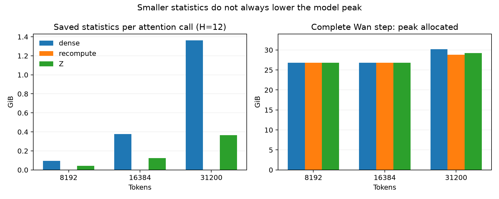

# GB10 saved-statistics replication

Independent batch on NVIDIA GB10 / SM121; no historical acceptance is inherited.
The requested “new hardware replication” label means a new experimental batch:
physical device identity was not proven different. Actual environment versions
match the handoff strings, rather than differing as anticipated.

Environment: aarch64, driver 580.173.02, Torch 2.12.0+cu130, CUDA 13.0,
Triton 3.7.0, FlashAttention 2.8.3+cu130torch2.12, NumPy 2.5.3.
Strict PyTorch determinism was enabled. Conclusions cover this configuration only.

## Findings

- **8192: statistics do not determine the whole-model peak.** All policies reached
  26.8053 GiB allocated. Z reduced each attention cache from 96.375 to 44.730 MiB
  (53.59%), but saved **zero bytes at the model peak**. The highest allocation
  appeared after backward, during gradient checking/clipping/optimizer work.
  Individual optimizer allocations were not separately profiled.
- **16384: all policies again reached 26.8023 GiB allocated.** Cache compression
  did not lower this model peak.
- **31200: statistics contribute to the backward peak.** Dense reached 30.1867 GiB,
  recompute 28.8253 GiB, and Z 29.1988 GiB. Z saved 0.9879 GiB (3.27%) versus dense;
  existing recompute saved 1.3614 GiB (4.51%). Z reserved 38.3574 GiB, slightly more
  than dense's 38.0098 GiB: live-allocation savings do not guarantee lower reservation.
- Recompute saves no forward statistics, but reconstructs dense history in backward.
  Its isolated attention peak increased while its long-sequence model peak decreased.
  Checkpointing and allocation lifetime explain why isolated cache accounting is insufficient.
- **Production defaults remain dense/TMA.** No new production switch or lossy/coarser
  format was added. Short-sequence peak memory is constrained elsewhere; the existing
  recompute mode already provides the largest measured long-sequence peak reduction.
  Z remains a private memory/latency tradeoff. Further production-format changes are
  deferred pending a concrete memory requirement and valid paired timing evidence.

## Isolated attention

B1/H12/D128, BF16, noncausal, seed 1000; two warmups and five measured
forward/backward calls per fresh process. No optimizer. Payload includes denominator;
Z also includes directory/counts/flags/spill structures. Its actual saved bytes matched
`_sm121_local_cache_bytes`. Peaks include inputs and temporary work.

| Tokens | Policy | Statistics MiB | Allocated GiB | Reserved GiB | Median wall ms |
|---:|---|---:|---:|---:|---:|
| 8192 | dense | 96.375 | 0.3761 | 0.3770 | 48.018 |
| 8192 | recompute | 0.000 | 0.4233 | 0.4238 | 64.624 |
| 8192 | Z | 44.730 | 0.3262 | 0.3262 | 51.126 |
| 16384 | dense | 384.750 | 0.9397 | 0.9414 | 188.580 |
| 16384 | recompute | 0.000 | 1.0342 | 1.0352 | 317.589 |
| 16384 | Z | 127.711 | 0.6894 | 0.6914 | 253.802 |
| 31200 | dense | 1393.945 | 2.4422 | 2.4609 | 909.501 |
| 31200 | recompute | 0.000 | 2.6233 | 2.6406 | 1218.335 |
| 31200 | Z | 374.596 | 1.4474 | 1.4629 | 926.955 |

## Complete Wan training step

Wan2.1-T2V-1.3B, full checkpointing, G1, seed 1000, LR 1e-6, no warmup schedule,
clip 1.0. Each process ran one warmup update and two measured updates on the same
cached batch with advancing paired noise RNG. The 16384 case uses a trilinearly
resized 8192 latent; it is a synthetic geometry extension. Other lengths use original
cached latents. No convergence or validation-set experiment was performed.

Timing includes forward, checkpoint backward, gradient finite checks, clipping,
optimizer/scheduler update, zeroing and synchronization. Batch loading and final hashes
are outside timing. The first update is excluded; subsequent JIT activity was not
independently traced. These are diagnostic step times, not production throughput.

| Tokens | Policy | Allocated GiB | Reserved GiB | Median step s | Observed delta vs dense |
|---:|---|---:|---:|---:|---:|
| 8192 | dense | 26.8053 | 29.4512 | 10.175 | +0.00% |
| 8192 | recompute | 26.8053 | 29.4570 | 10.666 | +4.83% |
| 8192 | Z | 26.8053 | 29.4512 | 10.367 | +1.88% |
| 16384 | dense | 26.8023 | 31.6289 | 22.173 | +0.00% |
| 16384 | recompute | 26.8023 | 31.2539 | 26.420 | +19.16% |
| 16384 | Z | 26.8023 | 31.3516 | 25.859 | +16.62% |
| 31200 | dense | 30.1867 | 38.0098 | 82.802 | +0.00% |
| 31200 | recompute | 28.8253 | 35.9922 | 107.487 | +29.81% |
| 31200 | Z | 29.1988 | 38.3574 | 93.976 | +13.50% |

**Clock confound:** order was dense/recompute/Z, without randomized paired rounds.
Busy-clock P50 was 1794 MHz for all 8192 runs; it fell across 16384 runs, and from
1391 MHz for 31200 dense to 981 MHz for recompute/Z. Whole-process quantiles include
warmup. Long-sequence timing deltas cannot be attributed entirely to statistics policy;
**no 5% performance certification is claimed**. Raw samples and clock telemetry remain.
Thermal guard and clock policy were unchanged. Duty and Ollama services were not stopped.
The manual two-lock hold was released for this batch and restored afterward.

At 8192, observed Z overhead was 1.88% with matching whole-process clock quantiles,
but only two measured updates. At 31200, Z was 12.57% faster than recompute in this
small sample, with about 0.374 GiB more peak allocated and 2.365 GiB more reserved.
These observations are not general performance guarantees.

Checkpointing means summing all layers' logical cache bytes does not measure
simultaneously resident memory. Per-call caches, phase peaks and fallback metadata
are available in the individual model JSON files.

## Numerical and boundary checks

- At all three lengths, first measured attention O/dQ/dK/dV hashes matched across
  dense/recompute/Z; every repetition was finite.
- All 825 final model parameter hashes matched across policies after three updates.
  Paired input metadata, every loss, gradient norm and event count also matched.
  Each update had 825 post-accumulate events. Optimizer-state equivalence and complete
  FA2 event coverage were not separately certified in this small diagnostic.
- Independent Torch dV relative L2 was **3.1051e-4 / 4.4457e-4 / 6.1807e-4** for
  8192/16384/31200, below 1e-3. References use separate B1/H1/D128 dense draws.
  Probability quantization and dV accumulation are independent Torch operations,
  conditioned on saved quantized Q/K and online maxima/denominator. This does not
  constitute an independent entire-forward or entire-model reference.
- Synthetic one-tile overflow used exactly one spill tile and matched dense hashes.
  All-tile overflow attempted 256 spill tiles, selected dense with `cache_not_smaller`,
  and matched dense hashes. Real 31200 Z training also exercised local replay without
  whole-layer fallback.
- CPU evaluation of the actual dispatch at 65534/65535/65536/65537 KV tiles confirmed
  that more than 65535 selects dense; force-short cannot bypass it. This is a host
  routing proof, not a two-million-token GPU acceptance. Dense fallback still scales
  quadratically and may OOM at extreme shapes.

## Checks, failure and reproduction

Before GPU execution: **111 experiment tests + 18 FA2 policy tests passed**.
Expanded experiment suite: **123 passed**, including 12 new checks. A guarded rerun
explicitly forbade CUDA initialization and passed. Changed-file pre-commit passed;
repository configuration intentionally skips most lint hooks for `fastvideo-kernel/`.

Asset commit `94eb140ffd359f8546868c938853971167f7f6ff` passed all **192 SHA256 checks**.
Base handoff commit: `283871a024f9e94bdc8f263b0866e59f21bbed3d`.
Unchanged kernel SHA256:
`477cf40132176b4e430295ca830e3e35a9928698b68ba99ba5f52dbe7ae03407`.

One failed setup attempt is preserved in `model-8192-dense.json`: the initial private
harness resolved a placeholder before substituting CLI paths and failed before model
loading/backward. Corrected `model-v2-*` attempts used new directories. No OOM or numerical
invariant failed; no automatic retry loop was used. Reverse `harness-v1-to-v2.patch` in a
disposable checkout to reconstruct the initial harness used by the kernel measurements.
Only model configuration resolution differs between those harness versions.

[COMMANDS.sh](COMMANDS.sh) contains complete equivalent commands and budgets. Run from
repository root with explicit Python, two scheduler locks, fresh output root, model and
8192/31200 training parquet paths. It stops on failure and does not manage host services.
Input hashes are in model JSON; weights, videos, captures, raw tensors, machine paths
and video IDs are intentionally absent.

Individual JSON files record each attempt. `summary.json` and CSVs summarize results;
clock JSON/CSV files document timing limitations. CPU and uint16 checks have separate
JSON records. `original_result_sha256` links sanitized exports to retained originals;
`SHA256SUMS` hashes the published files themselves.



Regenerate scalar exports and the plot (CPU only):

```bash
python fastvideo-kernel/experiments/gb10_z/code/spark_report.py --runs "$WORK" --output "$EXPORT"
python fastvideo-kernel/experiments/gb10_z/code/spark_plot.py --results "$EXPORT"
```

The exporter expects the recorded `model-v2-*` naming and scheduler telemetry;
`COMMANDS.sh` provides equivalent individual GPU invocations for a new replication.
